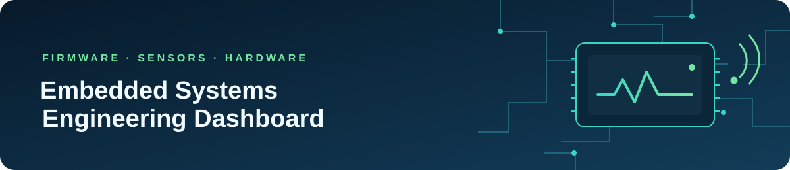

# Embedded Systems Engineering Dashboard

> Hands-on firmware exercises covering ESP32 and Arduino programming, sensor data, peripheral control, and device-to-device communication.
>
> **Generated:** 2026-10-25 11:37 UTC · **Refresh:** daily by GitHub Actions

| Firmware examples | Source lines | Sensor/input types | Interface types |
|:---:|:---:|:---:|:---:|
| **9** | **323** | **2** | **5** |

## Project overview

- **Focus:** embedded programming, sensors, microcontrollers, hardware interfacing, and firmware development
- **Platform evidence:** ESP32
- **Build setup:** No repository-level build manifest found; sketches are inventoried as source examples.
- **Source inventory:** `esp32/` (`.ino`)

## Firmware activity inventory

The table is regenerated from the source files in `esp32/`. Detected concepts are based on code patterns and are intended as a quick index, not a substitute for checking the sketch and its wiring.

| Activity | Engineering concepts detected | Non-blank lines |
|---|---|---:|
| [01 · Digital and analog I/O](esp32/activity_01_digital_analog_io.ino) | Analog input / potentiometer, GPIO digital I/O, PWM output, UART / serial | 16 |
| [02 · Serial control and DHT11 monitoring](esp32/activity_02_serial_communication.ino) | DHT11 temperature and humidity sensor, GPIO digital I/O, UART / serial | 43 |
| [03 · Bluetooth serial control and monitoring](esp32/activity_03_bt_serial_communication.ino) | ESP32, DHT11 temperature and humidity sensor, GPIO digital I/O, UART / serial, Bluetooth Classic serial | 49 |
| [03 · Bluetooth master](esp32/activity_03_master.ino) | ESP32, UART / serial, Bluetooth Classic serial | 41 |
| [03 · Bluetooth slave](esp32/activity_03_slave.ino) | ESP32, DHT11 temperature and humidity sensor, GPIO digital I/O, UART / serial, Bluetooth Classic serial | 44 |
| [03A · Bluetooth LED control](esp32/activity_03a_bt_led_control.ino) | ESP32, GPIO digital I/O, UART / serial, Bluetooth Classic serial | 26 |
| [03B · Bluetooth DHT11 monitoring](esp32/activity_03b_bt_dht_monitoring.ino) | ESP32, DHT11 temperature and humidity sensor, UART / serial, Bluetooth Classic serial | 35 |
| [04 · I2C sensor and OLED display](esp32/activity_04_i2c_communication.ino) | DHT11 temperature and humidity sensor, Analog input / potentiometer, UART / serial, I2C, SSD1306 OLED | 50 |
| [Servo control with a potentiometer](esp32/test.ino) | Analog input / potentiometer, UART / serial, Servo motor | 19 |

## Engineering capability map

Capabilities below are included only when the generator finds evidence in the firmware source. The file links point to examples that use each capability.

### Microcontrollers

- **ESP32:** [activity_03_bt_serial_communication.ino](esp32/activity_03_bt_serial_communication.ino), [activity_03_master.ino](esp32/activity_03_master.ino), [activity_03_slave.ino](esp32/activity_03_slave.ino), [activity_03a_bt_led_control.ino](esp32/activity_03a_bt_led_control.ino), [activity_03b_bt_dht_monitoring.ino](esp32/activity_03b_bt_dht_monitoring.ino)

### Sensors

- **DHT11 temperature and humidity sensor:** [activity_02_serial_communication.ino](esp32/activity_02_serial_communication.ino), [activity_03_bt_serial_communication.ino](esp32/activity_03_bt_serial_communication.ino), [activity_03_slave.ino](esp32/activity_03_slave.ino), [activity_03b_bt_dht_monitoring.ino](esp32/activity_03b_bt_dht_monitoring.ino), [activity_04_i2c_communication.ino](esp32/activity_04_i2c_communication.ino)
- **Analog input / potentiometer:** [activity_01_digital_analog_io.ino](esp32/activity_01_digital_analog_io.ino), [activity_04_i2c_communication.ino](esp32/activity_04_i2c_communication.ino), [test.ino](esp32/test.ino)

### Hardware interfaces

- **GPIO digital I/O:** [activity_01_digital_analog_io.ino](esp32/activity_01_digital_analog_io.ino), [activity_02_serial_communication.ino](esp32/activity_02_serial_communication.ino), [activity_03_bt_serial_communication.ino](esp32/activity_03_bt_serial_communication.ino), [activity_03_slave.ino](esp32/activity_03_slave.ino), [activity_03a_bt_led_control.ino](esp32/activity_03a_bt_led_control.ino)
- **PWM output:** [activity_01_digital_analog_io.ino](esp32/activity_01_digital_analog_io.ino)
- **UART / serial:** [activity_01_digital_analog_io.ino](esp32/activity_01_digital_analog_io.ino), [activity_02_serial_communication.ino](esp32/activity_02_serial_communication.ino), [activity_03_bt_serial_communication.ino](esp32/activity_03_bt_serial_communication.ino), [activity_03_master.ino](esp32/activity_03_master.ino), [activity_03_slave.ino](esp32/activity_03_slave.ino), [activity_03a_bt_led_control.ino](esp32/activity_03a_bt_led_control.ino), [activity_03b_bt_dht_monitoring.ino](esp32/activity_03b_bt_dht_monitoring.ino), [activity_04_i2c_communication.ino](esp32/activity_04_i2c_communication.ino), [test.ino](esp32/test.ino)
- **Bluetooth Classic serial:** [activity_03_bt_serial_communication.ino](esp32/activity_03_bt_serial_communication.ino), [activity_03_master.ino](esp32/activity_03_master.ino), [activity_03_slave.ino](esp32/activity_03_slave.ino), [activity_03a_bt_led_control.ino](esp32/activity_03a_bt_led_control.ino), [activity_03b_bt_dht_monitoring.ino](esp32/activity_03b_bt_dht_monitoring.ino)
- **I2C:** [activity_04_i2c_communication.ino](esp32/activity_04_i2c_communication.ino)

### Peripherals

- **SSD1306 OLED:** [activity_04_i2c_communication.ino](esp32/activity_04_i2c_communication.ino)
- **Servo motor:** [test.ino](esp32/test.ino)

## Suggested engineering progression

1. **01 · Read inputs** — Start with digital pins and ADC readings; record pin assignments, expected voltage ranges, and sample rates.
2. **02 · Drive outputs** — Control LEDs and servos safely, distinguish digital output from PWM, and verify the board-specific pin capabilities.
3. **03 · Connect sensors** — Read DHT11 measurements, handle failed samples, and document sensor timing and library dependencies.
4. **04 · Communicate** — Compare UART, Bluetooth Classic SPP, and I2C; define message formats and test disconnected or invalid-data cases.
5. **05 · Integrate firmware** — Combine sensor, display, and actuator paths; replace avoidable blocking delays with scheduled, non-blocking updates.

## Hardware bring-up and firmware checklist

- Confirm the exact board, core version, required libraries, and wiring before flashing.
- Check sensor voltage limits, common ground, pull-ups, and actuator power requirements.
- Keep a pin map with ADC/PWM capabilities and note pins reserved by boot, flash, or peripheral functions.
- Validate sensor readings and communication state before using them to drive outputs.
- Record serial baud rates, Bluetooth device names, I2C addresses, and reproducible test steps.

## Reference material

- [ESP32 Arduino core documentation](https://docs.espressif.com/projects/arduino-esp32/en/latest/)
- [Arduino language reference](https://docs.arduino.cc/language-reference/)
- [ESP32 BluetoothSerial API](https://github.com/espressif/arduino-esp32/tree/master/libraries/BluetoothSerial)
- [Adafruit SSD1306 library](https://github.com/adafruit/Adafruit_SSD1306)
- [Adafruit DHT sensor library](https://github.com/adafruit/DHT-sensor-library)

---

Dashboard source: [`dashboard/`](dashboard/) · Automation: [daily dashboard workflow](.github/workflows/dashboard.yml)
